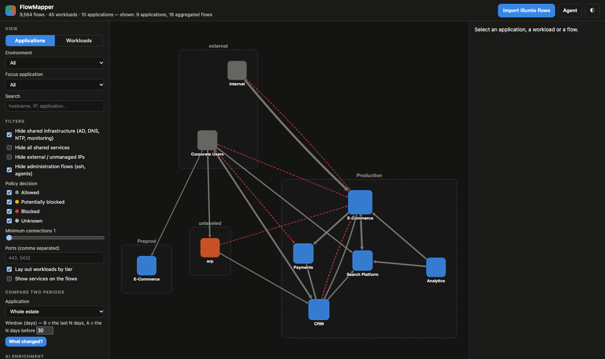
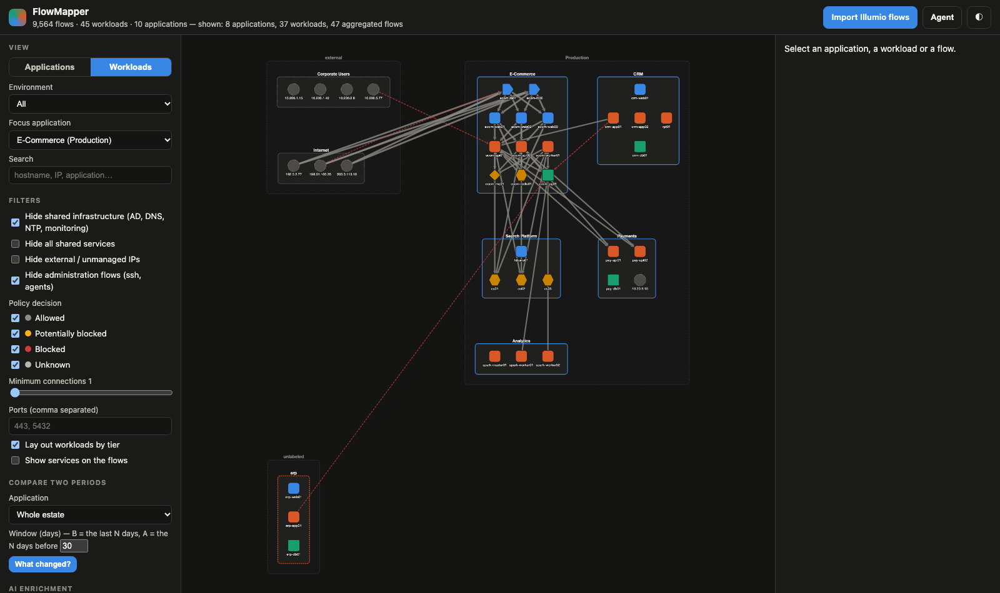

# FlowMapper — from Illumio flows to application architectures

FlowMapper ingests the network flows collected by Illumio (VEN → PCE), rebuilds the
application architectures as a graph (applications, tiers, dependencies, shared services)
and exposes everything to a LangGraph agent able to answer architecture questions and
propose labels for unclassified workloads.

```
Illumio PCE ──┬─ Explorer CSV export ───────┐
              ├─ traffic_flows/async API ───┼─► parsers ─► FlowGraph ─► discovery ─► exports (Cytoscape, Mermaid, Markdown, GraphML)
              └─ syslog / Fluentd (JSON) ───┘                 │                │
                                                              │                └─► web UI (FastAPI + Cytoscape.js)
                                                              └─► LangChain tools ─► LangGraph agent (chat)
```



## Quick start

```bash
pip install -e .                 # or: pip install .
cp .env.example .env             # LLM key + settings
flowmapper demo                  # generates a synthetic dataset and serves the UI on http://127.0.0.1:8000
```

With your own exports:

```bash
flowmapper stats   exports/explorer_export.csv            # summary + discovered applications
flowmapper report  exports/*.log --app "E-Commerce"        # Markdown report for one application
flowmapper report  exports/*.json --format mermaid         # Mermaid application map
flowmapper serve   exports/explorer_export.csv exports/syslog.log   # UI + API, several files merged
flowmapper chat    exports/explorer_export.csv             # command-line agent
flowmapper fetch   --start 2026-10-01 --end 2026-11-01 -o pce.json   # async Explorer query against the PCE
flowmapper snapshot exports/*.csv -o snapshot              # static copy of the UI to share (no backend)
```

Docker: `docker compose up --build` (drop your exports in `./exports`, set `FLOWMAPPER_FILES`).

## Accepted sources (auto-detected)

| Source | How to get it | Specifics |
|---|---|---|
| **Explorer CSV export** | PCE UI → Explorer → Export | `Consumer/Provider` headers (≤ 21.x) or `Source/Destination` (≥ 22.x); every `<side> <label type>` column becomes a label (custom types included). Timezone-less dates are assumed UTC. |
| **REST API** | `POST /api/v2/orgs/:id/traffic_flows/async_queries` then `GET …/download` (`flowmapper fetch` does it) | `[{key,value}]` labels, `num_connections`, `policy_decision`, `draft_policy_decision`, `timestamp_range`, IP lists. |
| **Syslog / Fluentd** | PCE *traffic flow summaries* export, one JSON object per line (syslog prefix tolerated) | `pd` 0/1/2/3 → allowed / potentially_blocked / blocked / unknown, `dir`, `pn`, `src_labels`/`dst_labels`. No IP-list names: provide `FLOWMAPPER_IP_LISTS`. |

Several files can be merged (CLI, `POST /api/ingest`, *Import* button).

## What discovery does

1. **Normalisation** — every flow becomes `src → dst` on a `(proto, port)` service with policy decision, connection count, process, timestamps.
2. **Workload graph** — identity = hostname (otherwise IP); flows are aggregated per pair and per service.
3. **Roles** — Illumio `role` label first, otherwise inferred from served ports (5432 → database, 6379 → cache, 443 → web…), otherwise hostname hints. Administration services (ssh, monitoring agents) are ignored.
4. **Applications** — grouped by `app`+`env` labels (configurable). VEN-less IPs are grouped by IP list or by /24.
5. **Shared infrastructure** — a node consumed by ≥ 3 applications is flagged *shared* (`infra` for AD/DNS/NTP/syslog/monitoring, `service` for a database or a bus consumed by several applications). Hidden by default in the diagrams.
6. **Unlabeled workloads** — clustered with Louvain communities on the traffic they exchange among themselves; a name is suggested from hostnames and services. Isolated ones (and VEN-less IPs outside any IP list) are *attached* to the only application they exchange with (e.g. an HSM appliance used only by Payments).
7. **Tiers** — inside an application, distance to the data tier in the DAG of internal flows: front → middle → data.
8. Only effective flows (allowed / potentially blocked / unknown) shape the architecture; blocked flows stay visible but never create an attachment or a dependency.

## AI enrichment (human-in-the-loop)

The discovery pipeline is deterministic; the LLM runs in batch on what discovery cannot
decide, and **changes nothing without validation**:

- **Unlabeled clusters** → application name, Illumio `app`/`env` labels, role per workload, rationale.
- **Unknown roles** (no label, no known port) → role class + label, rationale.

```bash
flowmapper enrich exports/*.csv                 # pending proposals, printed
flowmapper enrich exports/*.csv --apply --min-confidence 0.8 -o proposals.json
FLOWMAPPER_AUTO_ENRICH=true flowmapper serve …  # run the enrichment after each ingest
```

In the UI: *AI enrichment* button, *Proposals* panel (accept / reject), affected nodes are
highlighted; an accepted proposal renames the cluster, records the labels to apply and
forces the role (`role_source = ai`). API: `POST /api/enrich`, `GET /api/proposals`,
`POST /api/proposals/{clusters|workloads}/{id}` `{action}`. The agent gets
`run_ai_enrichment`, `list_proposals`, `review_proposal`, `compare_periods`.

## Diff between two periods ("what changed in CRM this month?")

The flows are split into two time windows (by default B = the last N days, A = the N days
before, clamped to the dataset's range), one graph is built per window, then compared
structurally: applications and workloads added/removed, workloads that changed application,
application dependencies added/removed, new and gone flows, **policy decision changes**
(e.g. potentially_blocked → blocked after enforcement), ×2/÷2 volume variations (in
conn./day), role and tier changes. Administration flows and allowed shared infrastructure
are ignored to keep only the architecture.

```bash
flowmapper diff exports/*.csv --app CRM --days 30            # Markdown report
flowmapper diff exports/*.csv --split 2026-11-01             # A = before, B = after
flowmapper diff export_november.csv --baseline export_october.csv --app CRM   # two exports
```

UI: *Compare two periods* section → report in the details panel and highlighting on the
graph (green added, red removed, orange changed). API: `GET /api/diff?app=&days=&split=&a_start=…`,
`POST /api/baseline` then `GET /api/diff?mode=baseline`. Agent: `compare_periods` — the tool
returns the structured diff, the agent writes the narrative leading with the significant
changes and risks.

## UI



- **Applications** view (fcose) or **Workloads** view (deterministic diagram: environments → applications → tiers).
- Filters: environment, focus on one application and its neighbours, shared infrastructure, external IPs, administration flows, policy decisions, minimum connections, ports, search.
- Details panel: tiers, inbound/outbound dependencies with services, at-risk flows, cluster renaming (local model, nothing is written to the PCE).
- PNG, Mermaid, Markdown report and GraphML (Gephi / yEd) exports. Light/dark theme.
- Agent chat and AI enrichment (require an LLM key).

## Agent

`FLOWMAPPER_MODEL` accepts any LangChain model spec (`anthropic:claude-sonnet-5-5`,
`openai:gpt-5`, `ollama:qwen3`…). Exposed tools: `graph_overview`, `describe_application`,
`get_dependencies`, `search_flows`, `find_path`, `list_unlabeled_clusters`,
`rename_application`, `blocked_flows`, `workload_details`, `export_architecture`,
`run_ai_enrichment`, `list_proposals`, `review_proposal`, `compare_periods`.

Typical questions: "Describe the architecture of the CRM application", "What does Payments
depend on?", "Who calls the ecom-pg01 database?", "Propose a name and labels for cluster 1",
"Which flows will be blocked once we move to enforcement?", "Path between Internet and pay-db01".

## API

| Method | Route | Purpose |
|---|---|---|
| POST | `/api/ingest` (multipart `files`, `?replace=`) | import one or more exports |
| POST | `/api/ingest/pce` | async Explorer query against the PCE (`ILLUMIO_*` variables) |
| GET | `/api/graph?level=app|workload&env=&app=&hide_infra=&min_connections=&decisions=&ports=` | Cytoscape elements |
| GET | `/api/apps`, `/api/apps/{name}` | applications and detail (tiers, dependencies, Mermaid, Markdown) |
| POST | `/api/apps/{key}/rename` | rename / propose labels |
| GET | `/api/workloads/{name}` | workload detail |
| GET | `/api/export?format=mermaid|markdown|graphml|json` | exports |
| POST | `/api/options` | re-tune discovery (group_by, shared threshold, IP lists…) |
| POST | `/api/chat` `{message, thread_id}` | agent |

## Layout

```
flowmapper/
  models.py        normalised model (Endpoint, Flow, PolicyDecision)
  parsers/         explorer_csv.py · api_json.py · syslog_json.py · format detection
  knowledge.py     ports → services / role classes table, administration services
  graph.py         FlowGraph: nodes, aggregated edges, groups, application graph, dependencies
  discovery.py     labeled groups, Louvain clustering, attachments, shared infra, tiers
  exports.py       Cytoscape JSON, Mermaid, Markdown, GraphML, JSON
  pce_client.py    PCE REST client (async queries)
  store.py         shared state (flows, graph, renames, AI proposals, forced roles)
  enrich.py        batch AI enrichment (structured output) + HITL validation
  diff.py          structural diff between two periods / two exports, Markdown rendering
  agent/           tools.py (LangChain tools) · agent.py (create_agent + per-thread memory)
  api/             main.py (FastAPI) · static/ (Cytoscape UI, vendor bundled for offline use)
  snapshot.py      static export of the UI
  sample.py        synthetic dataset generator
tests/             pytest (parsers, discovery, exports, API)
```

## Limits and ideas

- Flows reported by both VENs (outbound on the source, inbound on the destination) are added up; volumes are orders of magnitude, not exact counters.
- Port-based roles are heuristics: extend `KNOWN_SERVICES` in `knowledge.py` for your middlewares.
- Ideas: persistence (SQLite/Neo4j) and snapshot history, Illumio ruleset generation from validated dependencies, applying validated labels to the PCE through the API.
